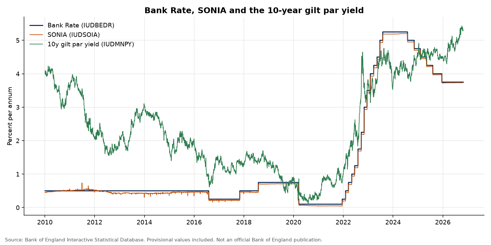
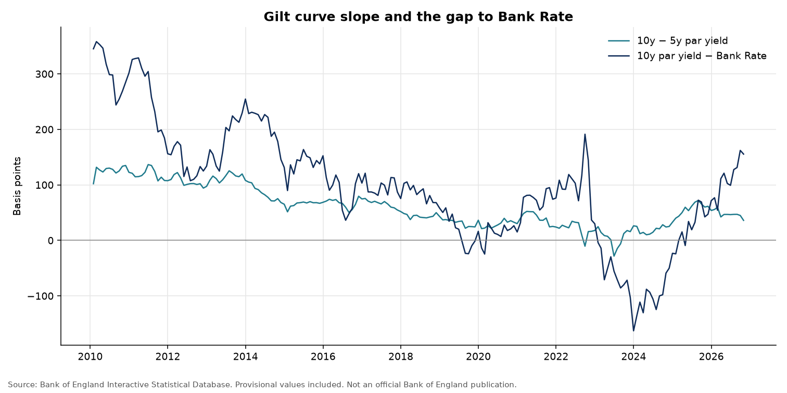
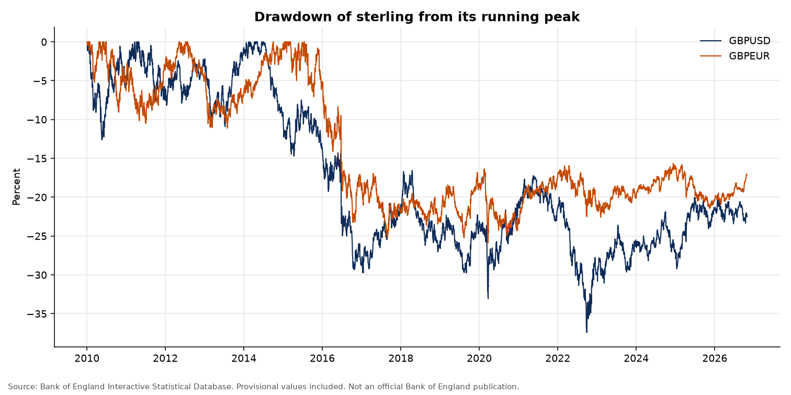
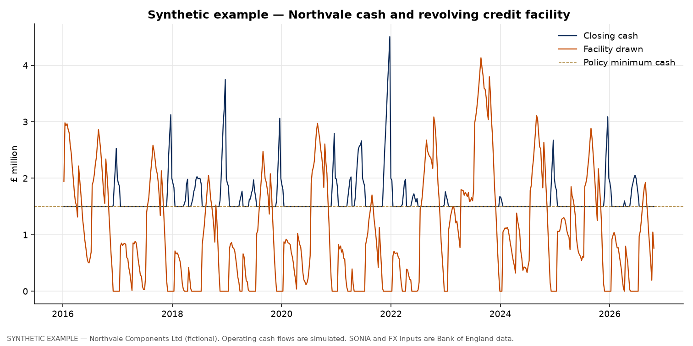
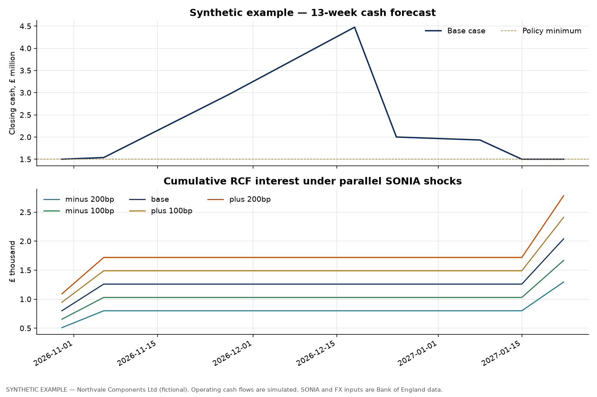
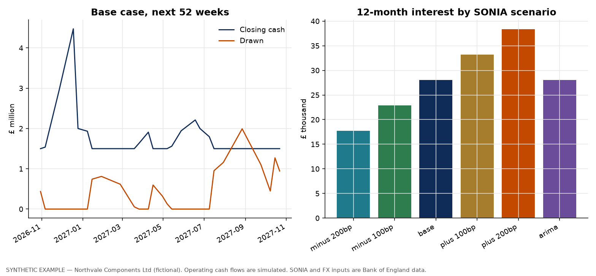
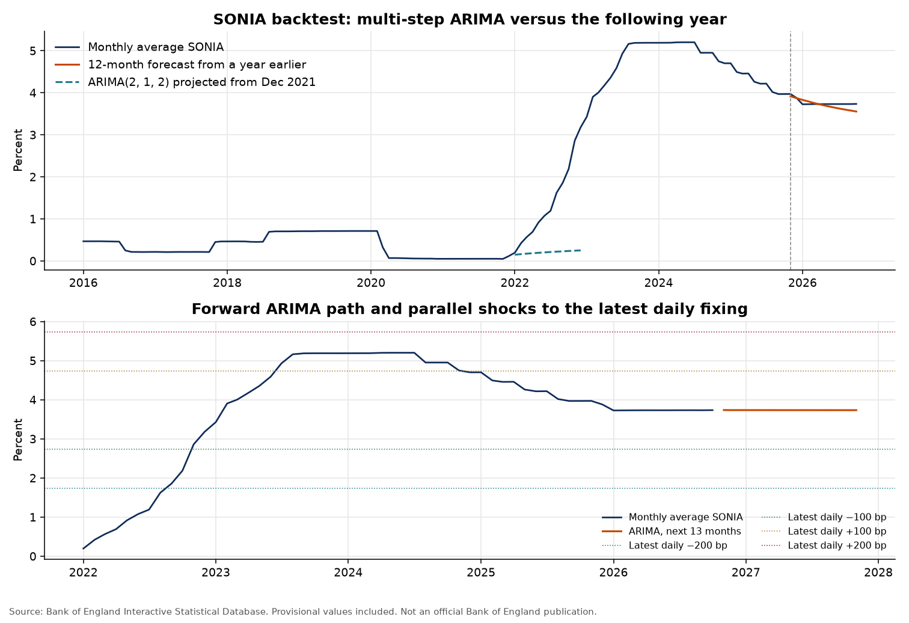
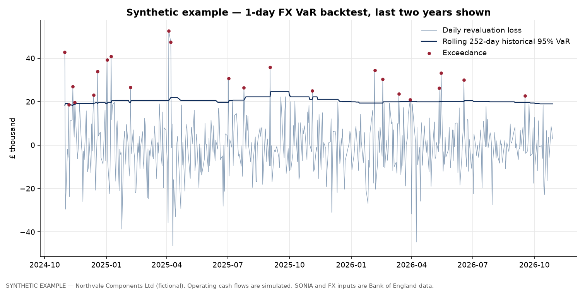
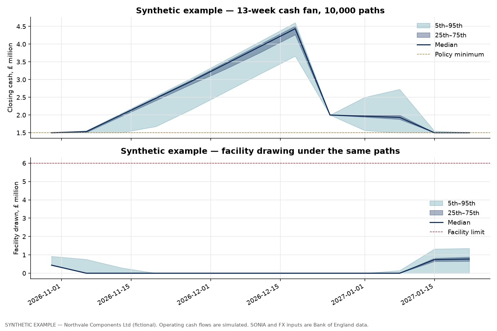

# UK corporate treasury analytics

A small, runnable treasury workbook for a fictional UK manufacturer. Market rates and FX are the Bank of England's published series. The company's cash flows are simulated, with a fixed seed, and labelled synthetic everywhere they appear.

The question the workbook answers is the one a treasury desk asks each week: what does the rate and FX market imply for funding cost, unhedged payables, and the chance of running out of cash or facility headroom over the next quarter?

Every figure below is taken from `outputs/tables/key_findings.json` or from a SQL extract in `outputs/tables/`, produced by `make all` on the download of 29 October 2026.

## What this is for

The project is a portfolio piece for treasury analyst and data analyst roles. It shows:

- pulling a real statistical feed and storing it in a form SQL can query
- separating observed market data from an example customer book
- turning a revolving credit facility into a ledger (draw, repay, interest, headroom)
- comparing a statistical rate path with the parallel shocks a treasurer actually uses
- measuring FX risk on a payable stock, then checking the measure with a VaR backtest
- running a joint liquidity stress and saying clearly when the limit is, and is not, the binding constraint

## Key findings

Sample: **4 January 2010 to 28 October 2026** (4,250 Bank of England business days). Bank Rate and both spot rates print through 28 October 2026. SONIA and the gilt par yields last print on **27 October 2026**; the newest business day was still blank for those series when the file was saved.

### Bank Rate, SONIA and the gilt curve

Bank Rate has had **26** regimes in the sample. It ranges from **0.10%** to **5.25%** (mean **1.4253%**) and has been **3.75%** since **18 December 2025**. SONIA ranges from **0.0394%** to **5.2001%** (mean **1.3832%**) and last printed at **3.7340%**. The daily SONIA–Bank Rate spread averages **−4.16 bp** (median **−4.35 bp**, **−4.90 bp** since 2022, **−1.60 bp** on the last common day).

The 10-year nominal par yield ranges from **0.1239%** to **5.4292%** and last printed at **5.3046%**, **155.46 bp** above Bank Rate. The gap was at its widest on the other side on **27 December 2023**, when the 10-year yield sat **172.10 bp** below Bank Rate.





### Sterling

GBPUSD (dollars per pound) moved from **1.6121** to **1.3301**, a **−17.49%** change, with a sample range of **1.0745** to **1.7169**. The worst peak-to-trough drawdown is **−37.42%**, on **28 September 2022**. GBPEUR moved from **1.1166** to **1.1940** (**+6.93%**), range **1.0681** to **1.4402**, with a worst drawdown of **−25.84%** on **23 March 2020**.

On the full daily sample, the correlation between SONIA changes and sterling log returns is **−0.0464** (GBPUSD) and **−0.0648** (GBPEUR), and the two sterling log returns correlate **0.5091**. Those three figures are the query result in `11_rate_fx_correlation.csv` (4,248 days), rounded to 4 decimal places.



### Synthetic example — Northvale Components Ltd (fictional)

Northvale is not a real company. Weekly operating items are simulated with seed 42. SONIA and the two spot rates used to convert foreign-currency costs and to price the facility are the Bank of England fixings.

The example is a sterling-invoicing manufacturer with dollar and euro material costs and a **£6,000,000** revolving credit facility at **SONIA + 175 bp**. Cash is swept back to a **£1,500,000** policy minimum. On the last Friday of June and of December, if the facility is undrawn, cash above a **£2,000,000** surplus cap is distributed. Interest is simple Actual/365 on the opening drawn balance.

Over **564** weeks from **8 January 2016** to **23 October 2026** the book shows:

| | |
| --- | --- |
| Receipts | £886,520,326.50 |
| Net operating cash flow | £15,823,192.53 |
| RCF interest | £464,864.62 |
| Distributions | £14,118,848.38 |
| Weeks with the facility drawn | 78.19% |
| Peak drawn | £4,132,638.46 (68.88% of the limit) |
| Closing cash / drawn at 23 Oct 2026 | £1,500,000.00 / £760,520.47 |
| Weeks below the £500,000 hard minimum | 0 |
| Weeks above the 80% soft utilisation trigger | 0 |
| Last-52-week cash interest cover | 79.65× |

The facility is a seasonal liquidity tool. Drawings build through late summer and fall away after the stronger receipt months. The 2023 peak, just over £4.1 million, is the tightest point in the example history, and it still leaves headroom inside £6 million. Cover looks high because a year of interest is small next to operating cash flow.



### Cash forecast and the cost of SONIA

The forecast starts from the 23 October 2026 ledger (cash £1,500,000.00, drawn £760,520.47, SONIA 3.7338%). FX is held at that week's fixing (1.3387 dollars and 1.1947 euros per pound). Operating items are the expected seasonal path. Flat SONIA scenarios are that fixing plus a parallel shift. One extra path uses the ARIMA projection, held constant inside each month.

Over 13 weeks the cash paths sit on top of each other at the scale of the chart, because the balance is on the sweep for much of the quarter and the rate only changes the interest bill. Over 52 weeks a +200 bp shift raises interest from **£28,026.79** to **£38,349.35** and leaves the facility **£7,021.90** more drawn at the horizon (£951,463.21 versus £944,441.31). Peak drawings over the year are about **£2.0 million** in every scenario. The ARIMA funding path (year-ahead SONIA **3.7325%**) produces **£28,023.05** of interest, in line with the flat base case.

| Scenario | SONIA | 13-week interest | 52-week interest | 52-week end drawn |
| --- | --- | ---: | ---: | ---: |
| −200 bp | 1.7338% | £1,295.29 | £17,758.30 | £937,455.85 |
| −100 bp | 2.7338% | £1,667.22 | £22,885.80 | £940,944.03 |
| Base | 3.7338% | £2,039.20 | £28,026.79 | £944,441.31 |
| +100 bp | 4.7338% | £2,411.24 | £33,181.30 | £947,947.70 |
| +200 bp | 5.7338% | £2,783.34 | £38,349.35 | £951,463.21 |
| ARIMA path | monthly path | £2,039.34 | £28,023.05 | £944,437.72 |





### Does a simple SONIA model earn its place?

Monthly average SONIA, 202 observations from January 2010 to October 2026. An ARIMA grid (p, q up to 2, d of 0 or 1; no drift once the series is differenced) selects **ARIMA(2, 1, 2)** on the sample that excludes the last 12 months (training AIC **−426.53**). Refit on the full sample, AIC is **−462.17**.

The genuine holdout is November 2025 to October 2026, a quiet year. The 12-month projection has MAE **7.88 bp**, RMSE **9.53 bp**, MAPE **2.1%** (actual mean 3.762%, projected mean 3.7154%, October 2026 actual 3.7331% versus projected 3.5533%). A 24-month one-step backtest has MAE **6.04 bp** and RMSE **7.74 bp** (MAPE **1.45%**).

The same order, with coefficients fit only through December 2021, projected through 2022 has MAE **119.30 bp** and RMSE **148.85 bp**. It finishes 2022 at **0.2495%** against an actual monthly average of **3.1779%** (2022 average actual 1.3962%, average projection 0.2032%). That order was chosen on a later sample, so the episode is an illustration of the path rather than a real-time model horse-race. It is still the right caution: over a calm year the errors are a few basis points; through the hiking cycle they are more than a percentage point. Parallel shocks around today's fixing are the decision tool. The ARIMA path is a baseline, and on this sample it is almost flat.



### FX risk on the unhedged payable stock

The exposure is the next four contractual weeks of purchases: **USD 3,594,963.95** and **EUR 967,874.91**, worth **£3,495,554.71** at the 23 October fixing (£2,685,414.17 and £810,140.54). Historical VaR uses the empirical loss on that constant foreign-currency stock. Parametric VaR is delta-normal and zero-mean, with 10-day figures scaled by √10. The current window is the last 252 one-day losses, ending 28 October 2026 (first loss in the window ends 30 October 2025). Daily loss volatility in that window is **£11,485.85**.

| | 95% | 99% |
| --- | ---: | ---: |
| Historical, 1 day | £18,946.75 | £30,196.52 |
| Parametric, 1 day | £18,892.54 | £26,720.08 |
| Historical, 10 day | £51,726.28 | £65,906.49 |
| Parametric, 10 day (√10) | £59,743.45 | £84,496.30 |

At 95% the two 1-day measures agree. At 99% the normal model is lighter than the historical tail on one day (£26,720.08 versus £30,196.52) and heavier once it is scaled to 10 days.

Kupiec unconditional-coverage test, 5% significance:

| Test | Hits | Expected | n | Hit rate | LR | p-value | Reject? |
| --- | ---: | ---: | ---: | ---: | ---: | ---: | --- |
| 1-day historical 95% | 215 | 199.85 | 3,997 | 0.05379 | 1.1810 | 0.277146 | No |
| 1-day historical 99% | 63 | 39.97 | 3,997 | 0.015762 | 11.4050 | 0.00073247 | Yes |
| 1-day parametric 95% | 200 | 199.85 | 3,997 | 0.050038 | 0.0001 | 0.99131525 | No |
| 1-day parametric 99% | 76 | 39.97 | 3,997 | 0.019014 | 25.9449 | 3.5e-07 | Yes |
| 10-day historical 95% | 27 | 19.90 | 398 | 0.067839 | 2.4105 | 0.12052446 | No |
| 10-day historical 99% | 10 | 3.98 | 398 | 0.025126 | 6.4785 | 0.01091863 | Yes |
| 10-day parametric 95% | 24 | 19.90 | 398 | 0.060302 | 0.8367 | 0.3603545 | No |
| 10-day parametric 99% | 3 | 3.98 | 398 | 0.007538 | 0.2664 | 0.60574463 | No |

The 95% measures are not rejected. Both 1-day 99% measures are: the book has fatter one-day tails than either a rolling historical 99% quantile or a normal model has been allowing. The 10-day parametric 99% test does not reject, on only 398 non-overlapping blocks and about four expected hits, so that pass is a thin one. The chart shows the last two years of the 1-day historical 95% backtest; the counts above use the full history.



### Liquidity stress

10,000 paths, seed 42, 13 weeks from 30 October 2026 to **22 January 2027**. Weekly shocks to SONIA, GBPUSD and GBPEUR are normal, zero-mean, and correlated by the Cholesky factor of the last **156** Friday-to-Friday changes (**3 November 2023** to **23 October 2026**). In that window the weekly standard deviations are **0.0483** percentage points for the SONIA change, **0.008912** for the GBPUSD log return and **0.005359** for GBPEUR. Correlations are **−0.0131**, **−0.0931** and **0.2388**. The sample mean SONIA change (**−0.0093** pp per week) is reported and then left out of the shocks, so the recent cutting cycle is not projected forward as a drift.

On top of that, each week there is a 5% chance that 40% of that week's contractual receipts slip by two weeks, and a 15% chance that 25% slip by one week. Money already in transit is not delayed again. Average receipts still in transit at week 13: **£116,167.29**.

| | |
| --- | --- |
| Probability the facility limit binds (cash cannot be restored to £1.5m) | 0 |
| Probability cash finishes a week below the £500,000 hard minimum | 0 |
| Probability of negative cash | 0 |
| 95% liquidity-at-risk, minimum closing cash | £1,500,000.00 |
| Shortfall versus the policy minimum at that percentile | £0.00 |
| 95% facility-at-risk, peak drawing | £1,395,029.89 |
| Undrawn headroom at that drawing | £4,604,970.11 |
| Median peak drawing | £862,678.85 |
| Median / 95th percentile of drawings at week 13 | £771,565.96 / £1,354,925.56 |
| Median / 95th percentile of interest over 13 weeks | £2,142.57 / £3,585.80 |

The minimum-cash LaR equals the policy floor because the horizon opens on that floor and, in all 10,000 paths, undrawn headroom is enough to defend it. The next 13 weeks are also the stronger receipt season. The number that moves is the drawing: a bad path uses about **£1.40 million** of a **£6 million** line. A summer origin would be the tighter test; the historical peak drawing of **£4.13 million** is the reminder of when that is.



## Data

Bank of England Interactive Statistical Database, CSV endpoint, downloaded **29 October 2026 20:19:57 UTC**. The raw file is `data/raw/boe_iadb.csv` (SHA-256 `be854625335af1ec641fbabae9435d8a187379de13e8d939fac77f2b9076a5d5`). `data/raw/SOURCE.md` records the URL, the retrieval and the licence. The first User-Agent returned the CSV; a browser User-Agent is coded as a fallback and was not needed on this run.

`VPD=Y` includes provisional values. The file is cached as the Bank sent it. Blank cells are not filled in.

| Code | Series | Unit |
| --- | --- | --- |
| `IUDBEDR` | Official Bank Rate | percent per annum |
| `IUDSOIA` | SONIA (Sterling Overnight Index Average) | percent per annum |
| `IUDSNPY` | Yield from British Government Securities, 5 year Nominal Par Yield | percent per annum |
| `IUDMNPY` | Yield from British Government Securities, 10 year Nominal Par Yield | percent per annum |
| `IUDLNPY` | Yield from British Government Securities, 20 year Nominal Par Yield | percent per annum |
| `XUDLUSS` | Spot exchange rate, US dollar into sterling | USD per GBP |
| `XUDLERS` | Spot exchange rate, euro into sterling | EUR per GBP |

Request URL (this run):

<https://www.bankofengland.co.uk/boeapps/database/_iadb-fromshowcolumns.asp?csv.x=yes&Datefrom=01/Jan/2010&Dateto=now&SeriesCodes=IUDBEDR,IUDSOIA,IUDSNPY,IUDMNPY,IUDLNPY,XUDLUSS,XUDLERS&CSVF=TN&UsingCodes=Y&VPD=Y&VFD=N>

Database home: <https://www.bankofengland.co.uk/boeapps/database/>

Contains public sector information licensed under the [Open Government Licence v3.0](https://www.nationalarchives.gov.uk/doc/open-government-licence/version/3/). Also subject to the [Bank of England terms](https://www.bankofengland.co.uk/legal/terms-and-conditions). This project is not affiliated with or endorsed by the Bank of England.

The example ledger is `data/synthetic/northvale_components_SYNTHETIC_weekly_cash_flows.csv`. It is simulated.

## Methods

- Daily market data land in SQLite (`rates`, `fx`). Twelve commented queries in `sql/` use CTEs and window functions for monthly averages, Bank Rate regimes, the SONIA spread, gilt-curve moves, FX returns and drawdowns, and the synthetic cash, facility, covenant and seasonality views. SQLite has no `CORR()`, so the Pearson correlation is written out.
- The company week ends on Friday. The fixing is the latest date on which SONIA and both spots had all been published, so a Friday holiday uses the previous business day and the week is still posted.
- Foreign-currency costs convert at that fixing. The facility draws up to its limit to restore the policy cash minimum, and surplus cash repays it. Interest is `drawn × (SONIA/100 + 0.0175) × 7/365`.
- The cash forecast, the historical ledger and the Monte Carlo paths share one posting function (`pipeline/cashflows.py`).
- SONIA is modelled on monthly averages. The cash-forecast shocks are parallel shifts of the latest daily fixing, held flat.
- VaR is on a four-week unhedged payable stock. The 10-day backtest uses non-overlapping blocks so the Kupiec hits are not the same move counted ten times.
- Liquidity shocks are zero-mean multivariate normal via Cholesky. Receipt delays are scenario settings, not estimated probabilities.

## How to run

From the repository root, with Python 3.11+:

```bash
python3 -m venv .venv
source .venv/bin/activate
pip install -r requirements.txt
make all
```

`make all` downloads the Bank of England file, reloads SQLite, runs the SQL, writes charts and tables, and runs pytest. Matplotlib uses the Agg backend. A rerun will pick up any newer Bank of England business day, so the figures can move; `outputs/tables/key_findings.json` is the audit trail for the numbers in this file.

## Project structure

```text
schema.sql                 SQLite tables
pipeline/download.py       IADB CSV cache and SOURCE.md
pipeline/load.py           parse, load, build the synthetic ledger
pipeline/cashflows.py      facility rules shared by history, forecast and stress
pipeline/run_queries.py    sql/*.sql to outputs/tables
sql/                       12 analytical queries
analysis/                  forecasts, VaR, Monte Carlo, charts
tests/                     calendar, ranges, ledger identities, seed, Kupiec
data/raw/                  unmodified BoE CSV plus licence note
data/synthetic/            SYNTHETIC weekly cash-flow extract
data/processed/treasury.db
outputs/figures/           charts
outputs/tables/            query extracts, model tables, key_findings.json
```

## Limitations

- Northvale Components Ltd, its receipts, costs, tax calendar, dividend and facility are synthetic. They are a worked example, not a customer book.
- A live sterling RCF usually charges compounded SONIA in arrears with a lookback. This ledger uses simple Actual/365 so the interest line rebuilds with one multiplication. The reconciliation tests check that identity.
- The payable VaR assumes the next four weeks of purchases are unhedged and already a fixed foreign-currency stock. A hedged book would show a smaller number. Ten-day parametric VaR scales with √10, which treats daily returns as i.i.d.
- Liquidity shocks are Gaussian and weekly. They do not put the SONIA move on MPC dates. The receipt-delay probabilities are chosen, not fitted. Delays are timing; cash still in the queue at week 13 has not been lost.
- The 13-week stress starts in late October, which is the stronger part of this company's year. The zero breach probability is the result for that window. It is not a statement about a July start.
- The 2022 SONIA episode uses an order selected on a sample that already includes later years. Read it as a picture of a no-drift projection into the hiking cycle.
- The newest Bank of England points can be provisional and can be revised. The newest gilt and SONIA prints can also lag the newest Bank Rate and FX prints by a business day.
- The covenant levels (hard cash minimum, 80% utilisation, 2× cover) are example triggers stored in `company_parameters`. They are not a loan agreement. Cover uses net operating cash flow, not accounting EBITDA.
- The book is weekly. Intraday liquidity, collateral and a hedge programme are out of scope.

## Author

Matthew Allmark — First Class BSc Mathematics, Sheffield Hallam University (2025). Pension Data Technician at Capita.

- LinkedIn: <https://www.linkedin.com/in/matt-allmark-6b6a17158>
- GitHub: <https://github.com/MatthewAllmark>

MIT Licence. Copyright 2026 Matthew Allmark.
